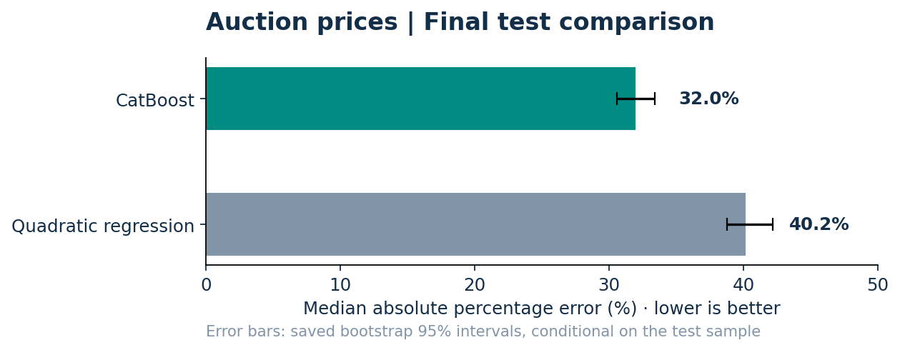

# Auction-Price Prediction
### Explaining and predicting realised used-equipment prices

**Question:** How much can nonlinear models improve on a transparent regression benchmark when auction data contain repeated scrapes, multiple currencies and sparse specifications?

**Finding:** CatBoost reduced final-test median absolute percentage error from **40.2% to 32.0%**, an **8.2 percentage-point improvement**. **47.6%** of predictions were within 30% of the realised price.



[**Results and uncertainty**](reports/RESULTS.md) · [**Executed notebooks**](notebooks/) · [**Dissertation**](reports/dissertation.pdf)

## The work behind the model

- Reduced **354,607 listings to 22,857 unique realised sales**, with explicit sample-construction rules.
- Compared regression, a decision tree, XGBoost and CatBoost; selected models using validation data.
- Used a **70/15/15 train/validation/test split**, stratified by currency and within-currency price quintile.
- Learned rare-category rules, imputations and within-currency target transformations from training data.
- Returned predictions to native price units and examined error by currency and model-series support.

Horsepower and transmission were explored but excluded from the final models because coverage was too sparse. The current predictors include manufacture year, usage, make, model series, country, currency, drive and equipment indicators.

## Run the analysis

Python 3.10+:

```bash
python -m pip install -r requirements.txt
jupyter lab
```

Open `notebooks/01_data_cleaning_and_eda.ipynb`, then `notebooks/02_model_training_and_testing.ipynb`. See [data/README.md](data/README.md) for the required source filename and working directory. Source listings are supplied separately and are not redistributed here; the saved notebook outputs and dissertation can be inspected without them.

## Why the remaining error matters

CatBoost's typical error is still substantial. Test MedAPE was **22.6%** for common model series and **44.0%** for rare or unseen series. There is no transaction date, so the random test split does not measure future-market performance or separate depreciation from market-wide price changes. See [the result note](reports/RESULTS.md).

**Author:** Fakhruddin Hakim Hussain · MSc Statistics with Data Science, University of Edinburgh  
[Portfolio](https://github.com/Fakhruddin12)
